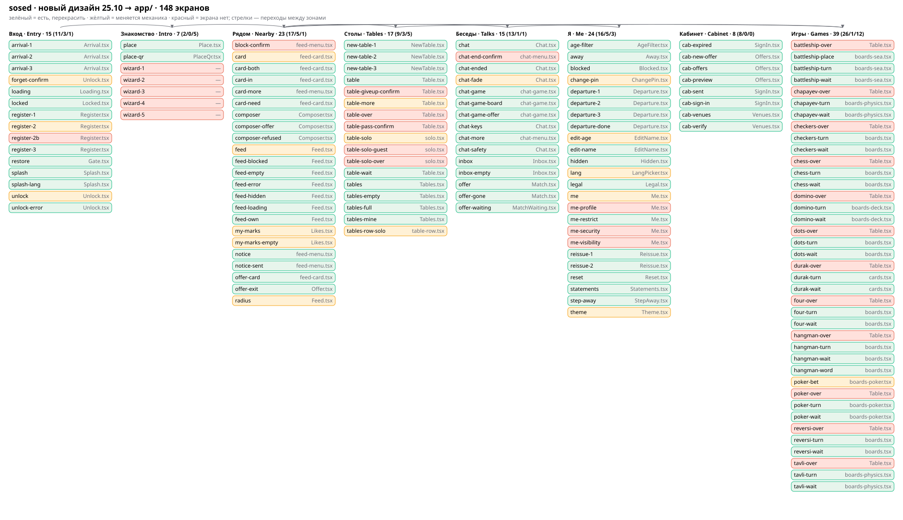

# sosed · new design 25.10 → the `app/` · plan

Pair: [NEWDESIGN_PLAN_RU.md](NEWDESIGN_PLAN_RU.md). Written 26.10.2026.

Source: the owner's archives in `docs/newdesing2/`: skeleton (`sosed-skeleton-2026-10-25-all.zip`), four themes
(`sosed-white|sea|plum|black-2026-10-25.zip`), README `sosed-README.md`. sosed only; neighbro is not in the archives.

## 0. Owner's decisions 26.10 (questionnaire)

| Question | Decision |
|---|---|
| Themes | 4 new (White, Sea, Plum, Black) + auto (White by day, Black by night); today's light/dark/auto go |
| Style | The new mockups win: relief, shadows with light from top left, colour icon chips. 15.10 «paper landing cards, big caps» is cancelled for sosed |
| Phrase card text | 3 sizes by phrase length, steps in tokens, card height in the feed unchanged |
| Wave 1 | Look + mechanics that need no node; node items B1–B13 are wave 2 after checking `relay/node` |

## 1. What the archives hold (checked by reading the zips 26.10)

| What | Count |
|---|---|
| Screens (distinct ids) | **148** = 146 skeleton + 2 added 26.10 (`table-pass-confirm`, `table-giveup-confirm`) |
| Widths | 390 × 844, 1440 × 900, 1920 × 1080 (games only at 390 and 1920) |
| SVG per theme | 615 (screens, icons, chips, elements sheet) |
| Icons | 106 in `icons/svg/` (`currentColor`, grid 48, line 4.5), 102 ready chips in `icons/chips/` |
| Tokens | `elements/tokens.css` + `tokens.json` per theme |
| Prototype | `prototype/index.html` (7.9 MB): 146 phone screens, 4 themes, transitions |
| Text | **Grey bars**: no type sizes in the mockups; text from `web/src/locales` |

## 2. Map

The map `docs/newdesign/flow-map.svg` and the table `docs/newdesign/inventory.csv` are built by
`scripts/design/newdesign-inventory.py`. It fails when the archive has a screen with no table row, when the table
has a screen the archive dropped, or when a named code file is missing. Test
`scripts/design/newdesign-inventory.test.py`: 8 checks. Checked with a break: dropping `cab-offers` from the table
goes red with «in archive, not in MAP».

Inventory: **148 of 148** screens mapped to code:

| Status | Count | Meaning |
|---|---|---|
| keep | 102 | the screen exists: recolour and relay out on the skeleton |
| change | 18 | the screen exists, its mechanics change |
| new | 28 | no screen |

Statuses come from the archive README and the code files' headers. Two first-pass errors were found against the code
and fixed: «how it works» is not in `Gate.tsx` (that is restore), and «forget identity» already asks with a second
tap (`Unlock.tsx:68-70`). **The other 146 rows are not checked live: each is confirmed by the wave 1 step that
redraws that screen.**

### New screens (28)

- **Entry:** `register-2b`, the PIN again as its own step.
- **Intro:** `wizard-1…5`, «how it works». No screens at all (`Me.tsx:10` «not here yet»).
- **Nearby:** `block-confirm`, block confirmation.
- **Tables:** `table-over`, `table-pass-confirm`, `table-giveup-confirm`, `table-solo-over`, `table-solo-guest`.
- **Talks:** `chat-end-confirm`.
- **Me:** `me-profile`, `me-visibility`, `me-security`. Section tiles; today all is one list in `Me.tsx`.
- **Games:** `*-over` × 12, the end of a game (won or lost, score, «another game»).

### Mechanics change (18)

| id | File | What changes |
|---|---|---|
| `feed`, `radius` | `Feed.tsx` | Radius: a sheet of tiles on the phone, 5 chips on desktop instead of the pill. Tables in the feed are one link tile |
| `my-marks`, `my-marks-empty` | `talks/Likes.tsx` | A toggle in the feed instead of its own icon |
| `card` | `feed-card.tsx` | The house's windows light up, 3 text sizes (§ 5) |
| `forget-confirm`, `unlock` | `Unlock.tsx` | Confirmation as its own screen instead of a second tap |
| `register-2`, `change-pin` | `Register.tsx`, `me/ChangePin.tsx` | Own PIN number pad |
| `me`, `theme`, `lang`, `edit-age` | `me/*.tsx` | Section tiles instead of 4 kinds of controls. Theme: 4 tiles and auto |
| `table-more` | `tables/Table.tsx` | «Pass» and «Give up» in the table's «…» menu, both with confirmation |
| `table-solo`, `tables-row-solo` | `tables/solo.tsx`, `table-row.tsx` | Row «playing alone · 1 of 2 · 0 watching» |
| `chat-fade` | `Chat.tsx` | Lifetime as a ring |
| `poker-bet` | `tables/boards-poker.tsx` | Raise in its own sheet |

## 3. Themes and tokens

1. Merge the 4 `tokens.css` into one `app/src/brands/sosed/themes.css`, one `:root[data-theme="white|sea|plum|black"]`
   block per theme. «Auto» through `prefers-color-scheme`: light scheme → white, dark → black.
2. Map today's app tokens (`--c-*`, `--fs-*`, `--r-*`) to the new ones (`--bg`, `--panel`, `--tile`, `--accent`,
   `--text`, `--primary`, `--r-panel 28 / --r-tile 20 / --r-inner 16`, `--gap 8`). The mapping table goes into this
   document as the first step of wave 1. Old names stay as aliases while any file refers to them, and a test checks it.
3. Shadow and relief: `--shadow-panel|tile|acc|chip`, `--relief-panel|tile|acc` and the `.lightwash` layer come from
   the tokens. The SVG draws the shadow in steps; CSS uses a real blur.
4. A person's saved theme: `light` → white, `dark` → black, `auto` → auto. Migrated on read, with a test for all three
   old values.

## 4. Icons

- Move the 106 icons from `icons/svg/` into `app/src/shell/icons.ts` (it holds its own set today). Colour through
  `currentColor`, soft fill through `--ifill`.
- Icon chip: square `big × 1.45`, radius `big × 0.42`, background = the icon's accent (`--acc-1…6`, the accent is
  fixed per icon). A `Chip` component, not copies of `icons/chips/`.
- Test: the set of icon ids is read from the archive folder, and every id the code refers to must exist. Report:
  N of 106.
- Decided 26.10: line style, «Me» is a little person, «Say» is a bubble with a plus.

## 5. Phrase card text size (decision 26.10)

Today there is one size, `--fs-card-text` (`app/src/screens/feed.css:76`). There will be three, the class set by
length in graphemes (`Intl.Segmenter`):

| Length | Size at 390 | Token |
|---|---|---|
| ≤ 40 | large, ~30 px | `--fs-card-text-l` |
| 41–100 | medium, ~22 px | `--fs-card-text-m` |
| > 100 | as today, ~18 px | `--fs-card-text` |

The pixels are a proposal. The final values are set by measuring: at 6 widths (320…1920) the longest phrase of each
size stays inside the card, and the card's height in the feed grid does not change. Test: a table of lengths 0, 40,
41, 100, 101, 280, including Georgian and emoji. The same holds for the open phrase (`card`) on desktop, where there
is more room.

## 6. Animation (prototype, 14 @keyframes)

`badge`, `bothp`, `dotpop`, `drift`, `fadein`, `fadeout`, `float`, `hintp`, `rise`, `selpop`, `sheetdown`,
`sheetup`, `tabpop`, `twinkle`.

| Token | ms | Where in the app |
|---|---|---|
| `--dur-0` | 90 | Tile press: shift of 1.5–2 px toward the shadow |
| `--dur-1` | 160 | State change in place: phrase → «you're here» |
| `--dur-2` | 240 | Tab change (`TabBar.tsx`), dimming under a sheet |
| `--dur-3` | 360 | Going deeper and back (`shell/layers.tsx`), a sheet from below on a spring, tiles appear in a 28 ms stagger |
| `--dur-4` | 520 | Long ones: «you're both here» |
| `--dur-ambient` | 16 000 | Clouds and windows in the landscape |

- **«I'm here too»:** the house's windows light up one by one, 90 ms apart. **«You're both here»:** a pop-up from the
  top and the icon pulses. A sticker flies out of the carousel on a spring. The lifetime ring runs down slowly, the
  turn ring faster.
- Today's motion lives in `shell/motion.test.ts` and `ripple.ts`. New durations come from the tokens with no numbers
  of their own in code, and a test checks it.
- Under `prefers-reduced-motion: reduce` every `--dur-*` is 0 and the landscape stands still. A test reads the CSS.
- How to check: a frame-by-frame Playwright test on `card` → `card-in` (state at start and end) and on a tab change.
  Animations a machine cannot check are listed in the report as not verified.

## 7. Wave 1 (no node): steps

Each step: file → action → check. A step closes only with a machine check. Widths 390, 1440 and 1920 from the archive
sheets, plus 320 and 768 by the adaptive rule.

1. `app/src/brands/sosed/themes.css`, `Theme.tsx`: 4 themes and auto, saved theme migration. Check: unit on the
   migration 3 of 3, a capture of `theme` at 3 widths.
2. `app/src/shell/icons.ts`, `Chip` component: 106 icons. Check: test N of 106.
3. Shell (`shell/App.tsx`, `TabBar.tsx`, the 112 rail on desktop): tabs, rail, three panes. An empty right pane is
   «nothing open». Check: `measure-app-wide` at 1440 and 1920.
4. Motion (`shell/layers.tsx`, `motion`): `--dur-*` tokens and reduced-motion. Check: no-numbers test and the
   frame-by-frame test.
5. Entry zone: `Splash`, `Register` (own PIN pad, the PIN again as its own step), `Unlock` (`forget-confirm` as its own
   screen), `Locked`, `Gate`, `Arrival`, `Loading`. Check: entry e2e green, the PIN repeat catches a mismatch.
6. «How it works» `wizard-1…5`: new screen. Check: e2e first entry → wizard → place → feed. Text × 17 languages.
7. Nearby: `Feed` (radius sheet and chips, «tables nearby» tile with no count yet), `feed-card` (§ 5, windows),
   `feed-menu` (`block-confirm`), «My marks» as a toggle. Check: `feed.test.ts` and feed e2e.
8. Tables: list, wizard, table, «…» menu with «Pass» and «Give up» and their confirmations. `table-over` and `*-over`
   × 12 from today's data: the winners and scores the node already counts (`relay/node/src/lib/tables_engine.ts:85-117`).
   Check: w3-games, give up → end-of-game screen.
9. Talks: `Inbox`, `Match`, `Chat` (`chat-end-confirm`, lifetime ring from today's fields). Check: chat e2e.
10. Me: section tiles (`me-profile`, `me-visibility`, `me-security`) and the right pane on desktop. Check:
    `me.test.ts` and captures.
11. Cabinet (8 screens): recolour. Check: cabinet tests.
12. Games (12): recolour the boards and the sticker carousel with today's 8 stickers. Check: w3-games, every
    `*-wait`/`*-turn` screen.
13. Text: new keys × 17 languages (icon labels, «end of game», «nothing open», «Start a game», «Say»). Check: the
    locale completeness test.
14. Crowd run (`scripts/flow/crowd.sh`) through every zone and the lens panel (`review-panel`).

## 8. Wave 2 (node): what was checked 26.10

| # | What | Checked against `relay/node` 26.10 |
|---|---|---|
| B1 | End of game: winner, reason, score | Winners and scores exist (`lib/tables_engine.ts:85-117`), giving up is `POST /tables/:id/resign` (`routes/tables.ts:702`, `lib/tables.ts:276`). No reason field (`score`/`resign`/`timeout`…) in the engine — to build |
| B2 | Turn deadline `turn_deadline` | Not found in `lib/tables*.ts` (grep `deadline`). To build |
| B3 | Solo puzzles × 11 games, «a neighbour asks to join» | A solo board exists for dots and battleship (`app/src/screens/tables/solo.tsx`); the rest to build |
| B4 | New stickers `think`, `nudge`, `lets_play` | 8 today (`depth/core/sticker.ts:9`). To build |
| B5 | «Your turn» limited to once per 60 s | No: `your_turn`/`nudge`/`remind` not found in `routes/tables.ts` and `routes/chat_games.ts` (only the `not_your_turn` refusal). To build |
| B6 | `expires_at` for the lifetime ring | One's own phrase: in the posting answer (`routes/feed.ts:234`). Others' phrases in the feed carry only a `soon` flag (`routes/feed.ts:484`), no share of the lifetime. To build a 0…1 share |
| B7 | Tables count in the circle | The density answer (`routes/feed.ts:659-687`) counts people only. To build |
| B8 | Search in the feed | Not in `routes/feed.ts` |
| B9 | Move hints | The node keeps whole rules only for reversi and four-in-a-row (`lib/tables_grid.ts:22-33`, `lib/tables_reversi.ts`). In checkers and chess legality «stays with the people» (`lib/tables_grid.ts:3,23`): hints there only through a client rules library |
| B10 | Place map | Infrastructure decision |
| B11 | Table row: seated, seats, watching | Seats exist (`routes/tables.ts:62`). The watcher count is only in `GET /tables/:id` (`routes/tables.ts:194-232`), not in the `GET /tables` list. Add it to the list |
| B12 | The open thing after a reload | `history.state`, no shareable link (`app/src/router.ts`) |
| B13 | Text × 17 | Wave 1, step 13 |

## 9. Open questions (asked as a questionnaire when the work reaches them)

- Games at 1440 are not drawn. By the README they are built as at 1920, only without the right message column.
- neighbro is not in the archives. Does it stay on today's look until its own package?
- Move hints (B9): only where the node checks moves, or a client rules library?
- Search in the feed (B8): build an endpoint, or drop the search from the 1920 header?

## 10. What this document does not do

It does not change app or node code, does not touch neighbro, and deploys nothing.
