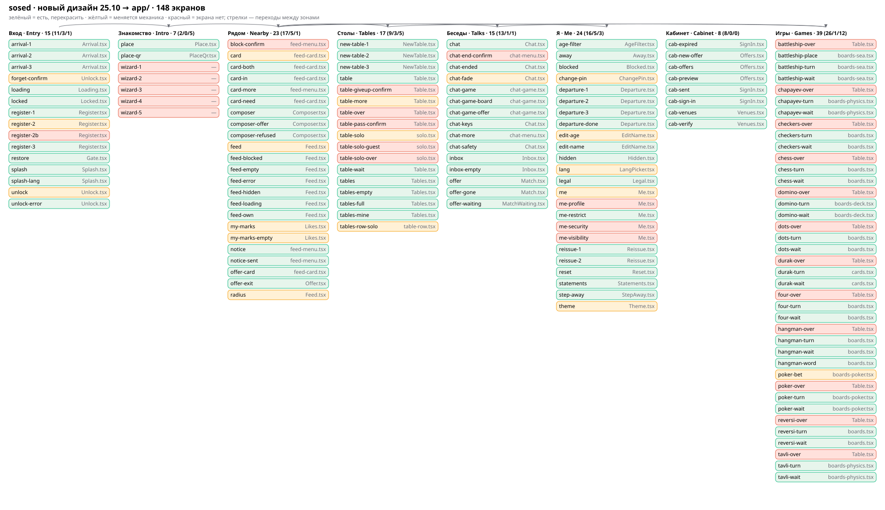

# sosed · новый дизайн 25.10 → приложение `app/` · план

Пара: [NEWDESIGN_PLAN_EN.md](NEWDESIGN_PLAN_EN.md). Составлено 26.10.2026.

Источник — архивы владельца в `docs/newdesing2/`: скелет (`sosed-skeleton-2026-10-25-all.zip`), четыре темы
(`sosed-white|sea|plum|black-2026-10-25.zip`), README `sosed-README.md`. Только sosed. neighbro в архивах нет.

## 0. Решения владельца 26.10 (вопросник)

| Вопрос | Решение |
|---|---|
| Темы | 4 новые («Белая», «Море», «Слива», «Чёрная») и «авто»: днём Белая, ночью Чёрная. Нынешние светлая, тёмная и авто уходят |
| Стиль | Новые макеты главнее: рельеф, тени со светом слева сверху, цветные чипы значков. Решение 15.10 «бумажные карточки лендинга, крупный капслок» для sosed отменено |
| Текст на карточке фразы | 3 размера по длине фразы, размеры заданы в токенах, высота карточки в ленте не меняется |
| Первая волна | Вид и механика, где узел не нужен. Пункты узла B1–B13 идут второй волной после сверки с `relay/node` |

## 1. Что в архивах (проверено чтением zip 26.10)

| Что | Число |
|---|---|
| Экранов (разных id) | **148**: 146 из скелета и 2 добавленных 26.10 (`table-pass-confirm`, `table-giveup-confirm`) |
| Ширины | 390 × 844, 1440 × 900, 1920 × 1080. Игры нарисованы только на 390 и 1920 |
| SVG в каждой теме | 615 (экраны, значки, чипы, лист элементов) |
| Значки | 106 в `icons/svg/` (`currentColor`, сетка 48, линия 4,5) и 102 готовых чипа в `icons/chips/` |
| Токены | `elements/tokens.css` и `tokens.json` в каждой теме |
| Прототип | `prototype/index.html` (7,9 МБ): 146 экранов телефона, 4 темы, переходы |
| Текст | **Серые полоски.** Кеглей в макетах нет, тексты берём из `web/src/locales` |

## 2. Карта

Карту `docs/newdesign/flow-map.svg` и таблицу `docs/newdesign/inventory.csv` строит
`scripts/design/newdesign-inventory.py`. Скрипт падает, если в архиве появился экран без строки в таблице, если в
таблице остался экран, которого больше нет в архиве, или если указанного файла кода нет на диске. Тест
`scripts/design/newdesign-inventory.test.py`: 8 проверок. Его проверяли поломкой: убранный из таблицы `cab-offers`
даёт красный с текстом «in archive, not in MAP».

Итог описи: **148 из 148** экранов привязаны к коду:

| Статус | Число | Смысл |
|---|---|---|
| keep | 102 | Экран есть, нужно перекрасить и переложить по скелету |
| change | 18 | Экран есть, меняется механика |
| new | 28 | Экрана нет |

Статусы поставлены по README архива и по заголовкам файлов кода. Две ошибки первого прохода найдены сверкой с кодом
и исправлены: «Как это работает» в `Gate.tsx` нет (там восстановление), а «забыть личность» уже спрашивает
подтверждение вторым нажатием (`Unlock.tsx:68-70`). **Остальные 146 строк вживую не сверены: каждую подтверждает
шаг волны 1, где этот экран переделывается.**

### Новые экраны (28)

- **Вход:** `register-2b`, повтор ПИНа отдельным шагом.
- **Знакомство:** `wizard-1…5`, «как это работает». Экранов нет совсем (`Me.tsx:10` — «not here yet»).
- **Рядом:** `block-confirm`, подтверждение блока.
- **Столы:** `table-over`, `table-pass-confirm`, `table-giveup-confirm`, `table-solo-over`, `table-solo-guest`.
- **Беседы:** `chat-end-confirm`.
- **Я:** `me-profile`, `me-visibility`, `me-security`. Это плитки разделов, сейчас всё лежит одним списком в `Me.tsx`.
- **Игры:** `*-over` × 12, конец партии (выиграл или проиграл, счёт, «ещё партию»).

### Меняется механика (18)

| id | Файл | Что меняется |
|---|---|---|
| `feed`, `radius` | `Feed.tsx` | Радиус: листок с плитками на телефоне, 5 чипов на десктопе вместо пилюли. Столы в ленте — одна плитка-переход |
| `my-marks`, `my-marks-empty` | `talks/Likes.tsx` | Переключатель в ленте вместо отдельного значка |
| `card` | `feed-card.tsx` | Окна домика загораются, 3 размера текста (§ 5) |
| `forget-confirm`, `unlock` | `Unlock.tsx` | Подтверждение отдельным экраном вместо второго нажатия |
| `register-2`, `change-pin` | `Register.tsx`, `me/ChangePin.tsx` | Своя цифровая клавиатура ПИНа |
| `me`, `theme`, `lang`, `edit-age` | `me/*.tsx` | Плитки разделов вместо 4 видов контролов. Тема: 4 плитки и «авто» |
| `table-more` | `tables/Table.tsx` | «Пас» и «Сдаюсь» в меню «…» стола, оба с подтверждением |
| `table-solo`, `tables-row-solo` | `tables/solo.tsx`, `table-row.tsx` | Строка «играет один · 1 из 2 · 0 смотрят» |
| `chat-fade` | `Chat.tsx` | Срок жизни кольцом |
| `poker-bet` | `tables/boards-poker.tsx` | Рейз отдельным листком |

## 3. Темы и токены

1. Склеить 4 файла `tokens.css` в один `app/src/brands/sosed/themes.css`, по блоку `:root[data-theme="white|sea|plum|black"]`
   на тему. «Авто» сделать через `prefers-color-scheme`: светлая схема → white, тёмная → black.
2. Нынешние токены приложения (`--c-*`, `--fs-*`, `--r-*`) сопоставить с новыми (`--bg`, `--panel`, `--tile`,
   `--accent`, `--text`, `--primary`, `--r-panel 28 / --r-tile 20 / --r-inner 16`, `--gap 8`). Таблица соответствий
   ляжет в этот документ первым шагом волны 1. Старые имена остаются псевдонимами, пока на них ссылается хоть один
   файл, и это проверяет тест.
3. Тень и рельеф: `--shadow-panel|tile|acc|chip`, `--relief-panel|tile|acc` и слой `.lightwash` берём из токенов.
   В SVG тень нарисована ступеньками, в CSS её делаем настоящим размытием.
4. Сохранённая тема человека: `light` → white, `dark` → black, `auto` → auto. Миграция при чтении и тест на все три
   старых значения.

## 4. Значки

- 106 значков из `icons/svg/` перенести в `app/src/shell/icons.ts` (сейчас там свой набор). Цвет через
  `currentColor`, мягкая заливка через `--ifill`.
- Чип значка: квадрат `big × 1,45`, скругление `big × 0,42`, фон — акцент значка (`--acc-1…6`, акцент закреплён за
  значком). Делаем компонентом `Chip`, а не копией `icons/chips/`.
- Тест: множество id значков читается из папки архива, и каждый, на который ссылается код, должен существовать.
  Отчёт: N из 106.
- Решено 26.10: стиль линейный, «Я» — человечек, «Сказать» — облачко с плюсом.

## 5. Размер текста на карточке фразы (решение 26.10)

Сейчас один кегль `--fs-card-text` (`app/src/screens/feed.css:76`). Будет три размера, класс ставится по длине в
графемах (`Intl.Segmenter`):

| Длина | Размер на 390 | Токен |
|---|---|---|
| ≤ 40 | крупно, ~30 px | `--fs-card-text-l` |
| 41–100 | средне, ~22 px | `--fs-card-text-m` |
| > 100 | как сейчас, ~18 px | `--fs-card-text` |

Пиксели — предложение. Окончательные значения подбираются замером: на 6 ширинах (320…1920) самая длинная фраза
каждого размера не вылезает из карточки, а высота карточки в сетке ленты не меняется. Тест — таблица длин 0, 40, 41,
100, 101, 280, в том числе грузинский и эмодзи. Так же действует открытая фраза (`card`) на десктопе, где места больше.

## 6. Анимации (прототип, 14 видов @keyframes)

`badge`, `bothp`, `dotpop`, `drift`, `fadein`, `fadeout`, `float`, `hintp`, `rise`, `selpop`, `sheetdown`,
`sheetup`, `tabpop`, `twinkle`.

| Токен | мс | Где в приложении |
|---|---|---|
| `--dur-0` | 90 | Нажатие плитки: сдвиг 1,5–2 px к тени |
| `--dur-1` | 160 | Смена состояния на месте: фраза → «ты тут» |
| `--dur-2` | 240 | Смена вкладки (`TabBar.tsx`), затемнение под листком |
| `--dur-3` | 360 | Переход вглубь и назад (`shell/layers.tsx`), листок снизу на пружине, плитки появляются лесенкой по 28 мс |
| `--dur-4` | 520 | Длинные: «вы оба тут» |
| `--dur-ambient` | 16 000 | Облака и окна в пейзаже |

- **«Я тоже тут»:** окна домика загораются по одному с шагом 90 мс. **«Вы оба тут»:** всплывашка сверху и пульс
  значка. Наклейка вылетает из карусели с пружиной. Кольцо срока жизни убывает медленно, кольцо хода быстрее.
- Нынешнее движение живёт в `shell/motion.test.ts` и `ripple.ts`. Новые длительности берём из токенов, своих чисел в
  коде нет, и это проверяет тест.
- При `prefers-reduced-motion: reduce` все `--dur-*` равны 0 и пейзаж стоит. Тест читает CSS.
- Как проверять: покадровый тест Playwright на `card` → `card-in` (состояние в начале и в конце) и на смену вкладки.
  Анимации, которые нельзя проверить машиной, перечисляю в отчёте как непроверенные.

## 7. Волна 1 (без узла): шаги

Каждый шаг: файл → действие → проверка. Шаг закрывается только машинной проверкой. Ширины 390, 1440 и 1920 по
листам архива, плюс 320 и 768 по правилу адаптива.

1. `app/src/brands/sosed/themes.css`, `Theme.tsx`: 4 темы и «авто», миграция сохранённой темы. Проверка: unit на
   миграцию 3 из 3, снимок `theme` на 3 ширинах.
2. `app/src/shell/icons.ts`, компонент `Chip`: 106 значков. Проверка: тест N из 106.
3. Оболочка (`shell/App.tsx`, `TabBar.tsx`, рейка 112 на десктопе): вкладки, рейка, три панели. Пустая правая панель —
   «ничего не открыто». Проверка: `measure-app-wide` на 1440 и 1920.
4. Движение (`shell/layers.tsx`, `motion`): токены `--dur-*` и reduced-motion. Проверка: тест на отсутствие чисел и
   покадровый тест.
5. Зона «Вход»: `Splash`, `Register` (свой ПИН-пад и повтор ПИНа отдельным шагом), `Unlock` (`forget-confirm` отдельным
   экраном), `Locked`, `Gate`, `Arrival`, `Loading`. Проверка: e2e входа зелёный, повтор ПИНа ловит несовпадение.
6. «Как это работает» `wizard-1…5`: новый экран. Проверка: e2e первый вход → wizard → место → лента.
   Тексты × 17 языков.
7. Рядом: `Feed` (листок радиуса и чипы, плитка «столы рядом» пока без числа), `feed-card` (§ 5, окна),
   `feed-menu` (`block-confirm`), «Мои отметки» переключателем. Проверка: `feed.test.ts` и e2e ленты.
8. Столы: список, мастер, стол, меню «…» с «Пас» и «Сдаюсь» и их подтверждениями. `table-over` и `*-over` × 12 по
   нынешним данным: победители и очки, которые узел уже считает (`relay/node/src/lib/tables_engine.ts:85-117`).
   Проверка: w3-games, сдача → экран конца партии.
9. Беседы: `Inbox`, `Match`, `Chat` (`chat-end-confirm`, кольцо срока по нынешним полям). Проверка: e2e беседы.
10. Я: плитки разделов (`me-profile`, `me-visibility`, `me-security`) и правая панель на десктопе. Проверка:
    `me.test.ts` и снимки.
11. Кабинет (8 экранов): перекраска. Проверка: тесты кабинета.
12. Игры (12): перекрасить доски и карусель наклеек по нынешним 8 наклейкам. Проверка: w3-games, все экраны
    `*-wait`/`*-turn`.
13. Тексты: новые ключи × 17 языков (подписи значков, «конец партии», «ничего не открыто», «Начать игру»,
    «Сказать»). Проверка: тест полноты локалей.
14. Проход толпы (`scripts/flow/crowd.sh`) по всем зонам и панель линз (`review-panel`).

## 8. Волна 2 (узел): что сверено 26.10

| # | Что | Сверка с `relay/node` 26.10 |
|---|---|---|
| B1 | Итог партии: победитель, причина, счёт | Победители и очки есть (`lib/tables_engine.ts:85-117`), сдача — `POST /tables/:id/resign` (`routes/tables.ts:702`, `lib/tables.ts:276`). Поля причины (`score`/`resign`/`timeout`…) в движке нет — сделать |
| B2 | Срок хода `turn_deadline` | В `lib/tables*.ts` не найдено (grep `deadline`). Нужно сделать |
| B3 | Задачи для игры одному × 11 игр, «сосед просится» | Одиночная доска есть у точек и морского боя (`app/src/screens/tables/solo.tsx`), остальное нужно сделать |
| B4 | Новые наклейки `think`, `nudge`, `lets_play` | Сейчас 8 (`depth/core/sticker.ts:9`). Нужно сделать |
| B5 | «Твой ход» с лимитом раз в 60 с | Нет: `your_turn`/`nudge`/`remind` в `routes/tables.ts` и `routes/chat_games.ts` не найдены (есть только отказ `not_your_turn`). Сделать |
| B6 | `expires_at` для кольца срока жизни | У своей фразы — в ответе на отправку (`routes/feed.ts:234`). В ленте у чужих только флаг `soon` (истекает скоро, `routes/feed.ts:484`), доли срока нет. Сделать долю 0…1 |
| B7 | Число столов в круге | В ответе плотности (`routes/feed.ts:659-687`) только люди. Сделать |
| B8 | Поиск в ленте | В `routes/feed.ts` нет |
| B9 | Подсказки ходов | Узел знает правила целиком только для реверси и «4 в ряд» (`lib/tables_grid.ts:22-33`, `lib/tables_reversi.ts`). В шашках и шахматах законность хода «остаётся за людьми» (`lib/tables_grid.ts:3,23`) — там подсказки только клиентской библиотекой |
| B10 | Карта места | Решение по инфраструктуре |
| B11 | Строка стола: сидят, мест, смотрят | Места есть (`routes/tables.ts:62`). Число зрителей отдаёт только `GET /tables/:id` (`routes/tables.ts:194-232`), в списке `GET /tables` его нет. Добавить в список |
| B12 | Открытая вещь после перезагрузки | `history.state`, ссылкой не поделиться (`app/src/router.ts`) |
| B13 | Тексты × 17 | Волна 1, шаг 13 |

## 9. Открытые вопросы (задам формой, когда до них дойдёт работа)

- Игры на 1440 не нарисованы. По README собираем как на 1920, только без правой колонки сообщений.
- neighbro: в архивах его нет. Он остаётся на нынешнем виде до своего пакета?
- Подсказки ходов (B9): показывать только там, где ходы проверяет узел, или подключать клиентскую библиотеку правил?
- Поиск в ленте (B8): делать эндпоинт или убрать поиск из шапки на 1920?

## 10. Чего этот документ не делает

Код приложения и узла не меняет, neighbro не трогает, ничего не выкатывает.
